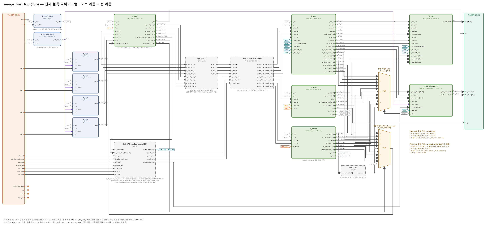
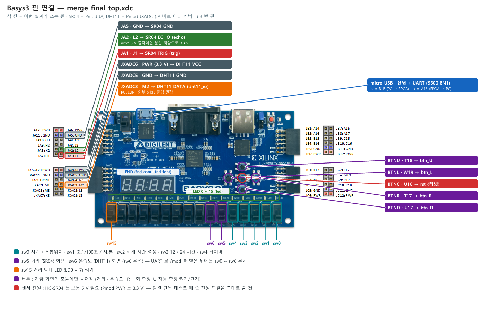
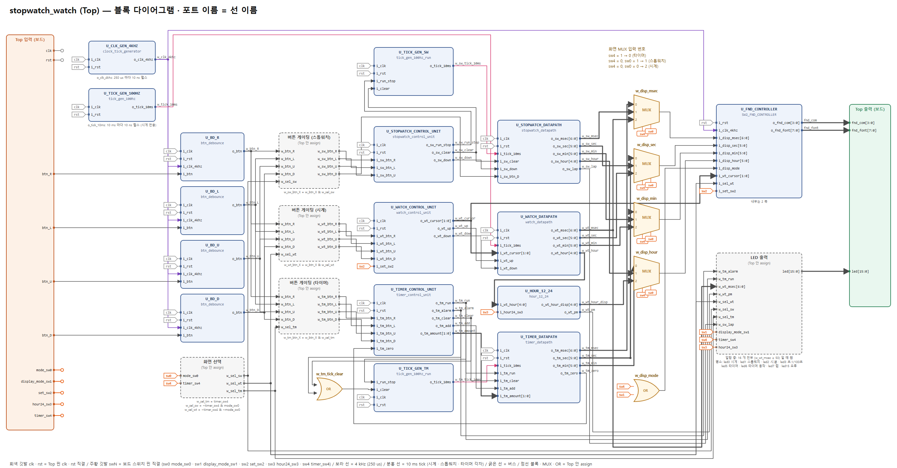

# UART 로 제어하는 Basys-3 통합 시스템 — 스톱워치 · 시계 · 타이머 + 초음파 · 온습도 센서

> AI 시스템반도체 설계 2기 · 2과목 Verilog HDL · **팀 프로젝트 (4인, Team 4)**
> 기간 2026-10-13 ~ 11-02 (MINI 10/13 ~ 10/19 → FINAL 10/20 ~ 11/02, 발표 11/02)
> 팀 저장소 원본 : [kimsacademy1234-max/BEST_Stop_watch_project](https://github.com/kimsacademy1234-max/BEST_Stop_watch_project) — 이 폴더는 그 설계 · 검증 파일의 11/03 사본

| 한눈에 | |
|---|---|
| 보드 · 툴 | Digilent Basys-3 (Artix-7 XC7A35T, 100 MHz 단일 클럭) · Vivado 2022.2 |
| 기능 | 스톱워치 · 시계 · 타이머 (WTS), 초음파 거리 (HC-SR04), 온습도 (DHT11), PC 터미널 UART 명령 · 응답 |
| 검증 | 그룹 TB 12 개 · 시나리오 92 · 검사 **305 / 305 PASS**, 버그 주입 Top 9 / 9 · UART sender 8 / 8 검출 |
| 자원 · 타이밍 | LUT 1,476 (7.1 %) · FF 738 (1.8 %) · WNS **+1.442 ns** @ 100 MHz (배치 · 배선 후) |
| 내 담당 | **UART sender**, SR04 컨트롤러, 트러블슈팅 v1 → v2 → v3 수정, 통합 TB, 발표 (sender · 트러블슈팅 · 시연 · 결론) |
| 발표 자료 | [`PROJECT_FINAL/Team4_Final.pdf`](PROJECT_FINAL/Team4_Final.pdf) · 블록 다이어그램 [`merge_final_block_diagram.pdf`](PROJECT_FINAL/block_diagram/merge_final_block_diagram.pdf) |

---

## 1. 목표와 결과

PC 터미널 한 곳에서 보드의 모든 기능을 바꾸고 · 누르고 · 값을 받아 보는 것이 목표였습니다.

| 목표 | 어떻게 | 확인 |
|---|---|---|
| ① UART 명령으로 통합 기능 제어 | 명령 6 종 · 명령 + 옵션 24 조합 (`/mod` 화면 · `/btn` 버튼 · `/set` 설정 …), 물리 버튼 · 스위치와 같이 사용 | 그룹 TB · 보드 시연 |
| ② 상태 · 센서 값을 PC 에서 확인 | `/get` 1 회 요청, `/auto` 1 Hz 자동 전송, 센서 오류는 FND 와 PC 모두 `Err1 ~ 3` | 통합 TB · 보드 시연 |

## 2. 팀 구성과 내 역할

| 팀원 | 맡은 모듈 · 작업 |
|---|---|
| **정보윤 (나)** | UART sender (숫자 → ASCII 한 줄), SR04 컨트롤러 + ILA 보드 확인, 트러블슈팅 ① (v1 → v2) · ② (v2 → v3) 수정, 통합 TB · sender 버그 주입, MINI 시계 FSM · 통합판 |
| 정안성 | UART 디코더 · 컨트롤러, 통합 Top, 그룹 TB 하네스 |
| 이종혁 | DHT11, MINI 스톱워치 초기 모듈 (랩) · 12/24 시간 |
| 견다혜 | SR04 Top, UART · FIFO 기초 모듈 |

내 작업 폴더 안내는 [§ 9](#9-폴더-안내) 에 있습니다.

## 3. 시스템 구조



**데이터 흐름 세 갈래**

1. **입력** : 버튼 4 개 → 디바운서 (4 kHz × 8 샘플 ≈ 2 ms) → 1 클럭 펄스. UART `/btn` 펄스와 OR 해서, 지금 보이는 화면의 모듈에만 전달.
2. **화면 선택** : 처음엔 스위치가 화면을 정하고, 정상 `/mod` 명령을 한 번 받은 뒤로는 리셋 전까지 UART 가 정함.
3. **출력** : FND 는 화면 값, PC 는 전송 MUX 가 고른 값 — 둘이 따로 있어서, 오류 상태를 두 곳에 똑같이 실어야 했음 (트러블슈팅 ①).

**UART 경로** (내 sender 는 응답 쪽)

```
rx → UART_RX → FIFO_RX(8) → ASCII 디코더 → 컨트롤러 ─(go · sel · 24 비트 값)→ ASCII sender → FIFO_TX(64) → UART_TX → tx
```

- **ASCII sender** : `send_go` 순간의 값을 잡아 두고 형식별 한 줄 (`12:34:56.78` · `045cm` · `55%24C` · `Err 2`) 을 한 클럭에 한 글자씩 TX FIFO 로. FIFO 가 차면 그 글자에서 기다렸다 이어서.
- **FIFO_TX 64** : 가장 긴 연속 전송 (`/auto all` 5 종 54 글자) 을 다 담는 크기.

| 블록 다이어그램 (쪽별) | |
|---|---|
| [UART](PROJECT_FINAL/block_diagram/img/2_uart.png) · [WTS](PROJECT_FINAL/block_diagram/img/3_wts.png) · [SR04 · DHT11](PROJECT_FINAL/block_diagram/img/4_sr04_dht11.png) · [FND](PROJECT_FINAL/block_diagram/img/5_fnd.png) · [LED](PROJECT_FINAL/block_diagram/img/6_led.png) | 선 이름 = 포트 이름이라 Vivado 파형에서 그대로 찾을 수 있음 |

**주요 사양**

| 항목 | 값 |
|---|---|
| UART | 9600 bps 8N1, 16 배 오버샘플링, 형식 오류 → `ERROR` 한 줄 |
| 전송 우선순위 | ERROR > `/get` · `/auto`, 보내는 중에 온 요청은 개수를 기억했다가 이어서 전송 |
| SR04 | 2 ~ 400 cm (0.1 cm 표시), 자동 측정 60 ms 주기 |
| DHT11 | 전원 후 1 s 대기, 측정 간격 2 s, 체크섬 확인 |
| 센서 핀 | SR04 trig JA1 · echo JA2, DHT11 data JXADC3 (PULLUP) |



## 4. 사용법

**스위치 · 버튼**

- 화면 : sw6 온습도 > sw5 거리 > sw4 타이머 > sw0 (0 시계 · 1 스톱워치). sw1 시.분 / 초.1/100초, sw2 시계 설정, sw3 12 / 24 시간, sw15 거리 막대 LED.
- 버튼 : 스톱워치 R 시작 · 정지 / L 지우기 / U 업 · 다운 / D 랩, 시계 (설정 중) R · L 커서 / U · D ±, 타이머 R +1 분 / L 시작 · 취소 / U +10 초 / D +10 분, 센서 화면 R 1 회 측정 / U 자동 측정 켜기 · 끄기. btnC 리셋.

**UART 명령** (`/<명령> <옵션>`, 글자 수가 다 차면 Enter 없이 실행)

| 명령 | 옵션 | 하는 일 |
|---|---|---|
| `/mod` | `w_hm` `w_ms` `s_hm` `s_ms` `t_hm` `t_ms` `dist` `temp` | 화면 바꾸기 |
| `/btn` | `R` `L` `U` `D` | 버튼 누르기 |
| `/get` | 공백 + Enter | 지금 화면 값 한 줄 |
| `/auto` | `all` `_sw` `_tm` `_wh` `dis` `tem` `off` | 1 초마다 전송 (`all` = 스톱워치 → 타이머 → 시계 → 거리 → 온습도) |
| `/set` · `/off` | `w_hm` · `w_h`, `24h⏎` · `12h⏎` | 시계 설정 켜기 · 끄기, 12 / 24 시간 |

**응답 · 오류 표시**

| 응답 | 예 | | 오류 | SR04 | DHT11 |
|---|---|---|---|---|---|
| 시간 3 종 | `00:01:23.45` | | `Err1` | echo 없음 | 응답 없음 |
| 거리 | `045cm` / `Err 2` | | `Err2` | 400 cm 넘음 | 수신 중 끊김 |
| 온습도 | `55%24C` / `--%--C` | | `Err3` | echo 고착 | 체크섬 틀림 |
| 형식 오류 | `ERROR` | | | | |

전체 명령 규칙 · 포트 · 핀 : [`PROJECT_FINAL/README.md`](PROJECT_FINAL/README.md)

## 5. 진행 과정

| 날짜 | 단계 | 한 일 |
|---|---|---|
| 10/13 ~ 10/19 | MINI | 스톱워치 · 시계 · 타이머 설계 → 통합판 → 검증 (TB 15 개 · 결함 주입 4) → 발표 ([부록](#부록-mini-프로젝트-wts)) |
| 10/20 ~ 10/29 | 모듈 | UART 루프백 → FIFO → ASCII 디코더, SR04 컨트롤러 (ILA 로 trig 11.01 us 확인) |
| 10/30 | 모듈 | UART sender + TB 3 개 (불일치 0), DHT11 Top, SR04 Top |
| 10/31 | 통합 v1 · v2 | 통합 Top, 센서 오류 `Err1 ~ 3`, 그룹 TB 12 개 · 블록 다이어그램 / 보드에서 FND · PC 표시 불일치 발견 → v2 |
| 11/01 | v3 | 그룹 TB 가 찾은 결함 8 건 수정 → 305 / 305, ILA · UART 시각 로거로 보드 Before / After |
| 11/02 | 발표 | `Team4_Final.pdf` |

통합하면서 포트 이름을 `i_` / `o_` 로 맞추고, 리셋 · 디바운서 · 1 us tick · FIFO · baud tick 을 공용 모듈 하나씩으로, FND · LED 를 통합 컨트롤러 하나로 합쳤습니다.

## 6. 검증

**방법** — 공통 하네스 + 영역별 그룹 TB

- 하네스 (`tb_merge_harness.sv`) 가 DUT = 통합 Top, 핀 모델 (버튼 채터링 · PC UART · SR04 echo · DHT11 40 비트), 모니터 (FND 문자열 · UART 줄 · LED), 스코어보드 (OK / FAIL 집계) 를 맡고, 그룹 TB 는 시나리오만 적음.
- **기대값은 설계 코드가 아니라 사양 표에서** (명령 표 · LED 표 · 데이터시트 58 us/cm · 9600 baud 13 글자 = 13.6 ms 등).
- `FAST = 1` 은 시간 파라미터만 줄여 빠르게, `FAST = 0` 은 실제 시간 (`top_tb/`).

| 그룹 | 영역 | 검사 | 그룹 | 영역 | 검사 |
|---|---|:-:|---|---|:-:|
| A | 리셋 | 14 | G | UART 수신 · 디코더 | 52 |
| B | 버튼 · 디바운스 | 14 | H | UART 컨트롤러 · 전송 | 31 |
| C | 모드 선택 | 30 | I | SR04 | 26 |
| D | 스톱워치 | 15 | J | DHT11 | 30 |
| E | 시계 | 23 | K | FND · LED | 28 |
| F | 타이머 | 16 | L | 통합 · 교차 | 26 |

- **결과** : v2 에서 305 중 297 PASS · 사양과 다름 8 → v3 에서 **305 / 305 PASS**.
- **통합 TB** (내 작업, `tb_top_full`) : 랜덤 명령 120 개 · 전송 MUX 100 번을 매 줄 비교, v2 · v3 모두 불일치 0.
- **TB 를 믿을 수 있나 — 버그 주입** : Top 에 버그 9 개를 하나씩 넣어 9 / 9 검출 (한 그룹 TB 가 놓친 2 개는 다른 그룹이 잡음). UART sender 버그 8 개도 8 / 8 — busy 중 `send_go` · FIFO 가득 참은 단위 TB 만, 센서 상태 비트 무시는 Top TB 만 잡아서 둘이 서로 보완.
- 시나리오 · 결과 전체 : [`TB_RESULT_SUMMARY_1031.md`](PROJECT_FINAL/sim_file/docs/TB_RESULT_SUMMARY_1031.md) · [`tb_scenario.md`](PROJECT_FINAL/sim_file/docs/tb_scenario.md)

## 7. 트러블슈팅

### ① FND 는 오류인데 PC 는 숫자 (v1 → v2)

| ① 현상 | 보드에서 FND `Err2` · `Err3` · `----` 일 때 PC 는 `400cm` · `00%00C` · 마지막 정상값 |
|---|---|
| ② 원인 | 센서 상태 선이 FND MUX 로만 가고 전송 MUX 에는 값만 들어감 → sender 는 숫자 글자만 만들 수 있었음 |
| ③ 해결 | 블록 · 포트 · 24 비트 폭은 그대로, 전송 MUX 의 빈 윗비트에 상태를 실음 (거리 2 비트 · 온습도 4 비트) → `sender_char_mux` 가 그 비트로 `Err N` · `--%--C` 선택 |
| ④ 결과 | 시뮬 불일치 0, 보드에서 FND 와 PC 표시 일치. 상세 [`v2_modified.md`](PROJECT_FINAL/source_file/v2_modified.md) |

### ② 그룹 TB 가 찾은 결함 8 건 (v2 → v3)

| ID | 현상 | 고친 내용 |
|---|---|---|
| G3 | `/set abcd` 에도 시계 설정이 켜짐 | 옵션이 `w_hm` 일 때만 |
| G7 | `/off` 오타 뒤 정상 `/off w_h` 도 계속 ERROR | 오류 때 `/off` 카운터도 초기화 |
| H7 | `/auto` 를 껐다 켜면 첫 줄이 0.54 초 만에 옴 | 끌 때 1 초 카운터 초기화 |
| H9 | `/get` 20 번 → 15 줄 | 대기 요청을 1 비트가 아니라 개수로 기억 |
| D7 | 랩 표시 중 `/get` → 랩 값 전송 | PC 에는 흐르는 값 |
| E6 | 초 화면에서 설정 + U → 안 보이는 분이 +1 | 시.분 화면에서만 설정 |
| L6 | 초가 넘어가는 클럭의 `/get` → 1 초 늦은 값 | 올림 신호를 같은 클럭에 |
| J14 | 습도 100 → `:0%24C` | 습도 · 온도 99 상한 |

| | v2 | v3 |
|---|---|---|
| 그룹 TB | 297 / 305 | **305 / 305** |
| LUT | 1,489 | 1,476 |
| WNS | +0.320 ns | **+1.442 ns** |

보드에서는 G3 · G7 · D7 · E6 를 터미널로, L6 를 ILA 로, H7 · H9 를 PC 수신 시각 기록으로 Before / After 확인 (영상 [`Member/boyun/videos_1101/`](Member/boyun/videos_1101/)). 상세 [`v3_modified.md`](PROJECT_FINAL/source_file/v3_modified.md)

## 8. 결론 · 고찰

**결론** — 두 목표 모두 시뮬레이션과 보드에서 동작. 그룹 TB 305 / 305, 버그 주입 Top 9 / 9 · sender 8 / 8, LUT 1,476 · WNS +1.442 ns.

**고찰**

1. **설계** : 결과가 FND 와 PC 두 곳으로 나가는데 FND 쪽만 챙겼다 (트러블슈팅 ①). → 두 출력이 같은 상태를 보이는지 TB 가 서로 비교하는 교차 검사가 필요.
2. **검증** : 설계자가 만든 통합 TB 는 결함 8 건에서 FAIL 을 내지 못했고 (그 상황이 시나리오에 없음), 사양 표에서 기대값을 만든 그룹 TB 는 잡았다. → 시나리오 · 기대값은 설계 코드가 아니라 사양에서 만든다.

## 9. 폴더 안내

```
BEST_Stop_watch_project/
├── PROJECT_FINAL/       최종 설계
│   ├── source_file/     merge_final (v1) · merge_final_v2 · merge_final_v3 (최종) + 수정 기록 md
│   ├── sim_file/        그룹 TB · 하네스 · 실제 시간 TB · 버그 주입 (mutants/) · wcfg
│   ├── block_diagram/   블록 다이어그램 PDF · 쪽별 PNG
│   ├── bitstream_file/  FINAL.bit
│   └── Team4_Final.pdf  최종 발표 자료
├── PROJECT_MINI_WTS/    1 차 미니 프로젝트 (WTS)
├── verification_v2/     MINI 검증판
└── Member/              팀원별 작업 폴더
```

| 내 작업 | 폴더 |
|---|---|
| UART sender + TB 3 개 | [`Member/boyun/uart_sender_20261030/`](Member/boyun/uart_sender_20261030/) |
| SR04 컨트롤러 · ILA | [`Member/boyun/sr04_controller_20261029/`](Member/boyun/sr04_controller_20261029/) |
| 트러블슈팅 ① · ② 수정본 | [`fix_b2b3_1031/`](Member/boyun/fix_b2b3_1031/) · [`fix_issue7_1101/`](Member/boyun/fix_issue7_1101/) · [`fix_j14_1101/`](Member/boyun/fix_j14_1101/) |
| sender 버그 주입 | [`Member/boyun/sender_bug_1101/`](Member/boyun/sender_bug_1101/) |
| UART 단계별 실습 | `Member/boyun/uart_20261020/` · `uart_fifo_ascii_*` |
| 발표 · 시연 영상 | [`ppt_1101/`](Member/boyun/ppt_1101/) · [`videos_1101/`](Member/boyun/videos_1101/) |
| MINI 통합판 · 타이머 TB | [`merged_v4/`](Member/boyun/merged_v4/) · [`timer_tb_verilog/`](Member/boyun/timer_tb_verilog/) · [`timer_sim_verification/`](Member/boyun/timer_sim_verification/) |

**실행** : 보드는 `PROJECT_FINAL/bitstream_file/FINAL.bit` 를 올리고 터미널 9600 8N1 에서 `/mod w_hm` 부터. 시뮬은 `PROJECT_FINAL/sim_file/` 에서 `run_xsim.bat tb_D_stopwatch` (그룹 전체) · `run_xsim.bat tb_D_stopwatch D3 wave` (시나리오 하나 + 파형). 자세히는 [`sim_file/README.md`](PROJECT_FINAL/sim_file/README.md).

**원본 저장소와 다른 점** : 1 기 교육생 포트폴리오 피드백 PDF 는 공개 금지 자료라 뺐고, `ppt_1101/` 발표 자료는 최종판만, 시연 영상 E 는 자막 수정판, Vivado 생성물은 제외했습니다.

---

## 부록. MINI 프로젝트 (WTS)

FINAL 의 WTS 블록이 된 1 차 프로젝트 (10/13 ~ 10/19). 폴더 [`PROJECT_MINI_WTS/`](PROJECT_MINI_WTS/README.md), 제출본 · 발표 자료는 [`../Mini_Project_watch/`](../Mini_Project_watch/README.md).



- 기능 : 스톱워치 (업 · 다운 · 랩), 시계 (자리 단위 설정 · 12 / 24 시간), 타이머 (최대 59:59, 0 이 되면 LED 16 개 점멸).
- 결정 : 100 Hz tick 하나를 셋이 같이 쓰면 시작 시점에 따라 첫 1/100 초가 최대 10 ms 일찍 바뀜 (10 초 타이머 = 9.998 초) → 스톱워치 · 타이머는 시작 순간부터 세는 전용 tick 으로 바꿔 10.000 초.
- 검증 : Top 기준 TB (스톱워치 3 · 시계 3 · 타이머 3 · 공통 2) + 결함 주입 4 (FND 고스팅 · 스위치 채터링 · 누름 시점 · 리셋 글리치), 클럭을 줄이지 않은 실제 시간 시뮬.
