# SR04 초음파 컨트롤러 — 보드 ILA 파형 (2026-10-29)

Basys-3 보드에서 SR04 컨트롤러를 ILA(Integrated Logic Analyzer)로 찍은 파형 정리.

## 결론

- **5 개 상태 천이 (IDLE → START → WAIT → DIST → STOP → IDLE) 를 보드에서 모두 확인.**
- trig 폭 **1,101 샘플 = 11.01 µs** (설정 11 µs).
- echo 입력 → 상태 변화는 **대부분 3 샘플, 가끔 2 샘플** : 2-FF 싱크로나이저 2 클럭 + ILA 가 레지스터 출력을 한 클럭 뒤에 보는 것, 비동기 입력이라 ±1 클럭.
- **ILA 로 잰 echo 폭 ÷ 58 = FND 표시값 (3 점 모두 일치)**. 자로 거리를 재지 않았으므로 센서 정확도가 아니라 회로 동작 검증.

## 측정 조건

| 항목 | 값 |
|---|---|
| 보드 · 클럭 | Basys-3 (xc7a35t), 100 MHz → ILA 1 샘플 = 10 ns |
| ILA 프로브 | `o_trig` · `i_echo` · `c_echo_sync1` · `c_echo_sync2` · `c_state[2:0]` |
| 샘플 깊이 | 01 ~ 04 : 16,384 (창 ≈ 164 µs) / 05 ~ 13 : 131,072 (창 ≈ 1.31 ms) |
| 상태 코드 | IDLE 0 · START 1 · WAIT 2 · DIST 3 · STOP 4 |
| 설계 상수 | TRIG_US 11 · CM_US 58 · MAX_CM 400 · STOP_US 10,000 · TIMEOUT_US 30,000 |
| 구현 결과 | WNS +3.893 ns · WHS +0.055 ns / 설계만 LUT 150 · FF 83, ILA 포함 LUT 1,367 · FF 2,089 · BRAM 4 |

## 1. 상태 천이 5 개

| 천이 | 트리거 | 확인한 것 | 캡처 |
|---|---|---|---|
| IDLE → START → WAIT | `o_trig` 상승 | trig 8192 → 9293 = 1,101 샘플 = 11.01 µs | `06` (`01` 은 16384 창) |
| WAIT → DIST | `i_echo` 상승 | i_echo (8192) → sync1 (8193) → sync2 (8194) → DIST (8195) | `07` |
| DIST → STOP | `i_echo` 하강 | 하강도 같은 3 샘플 계단 | `08` · 전체 창 `09` |
| STOP → IDLE | `c_state` 비트별 `F00` (100 → 000) | echo 끝 후 10 ms 대기 뒤 IDLE | `10` |

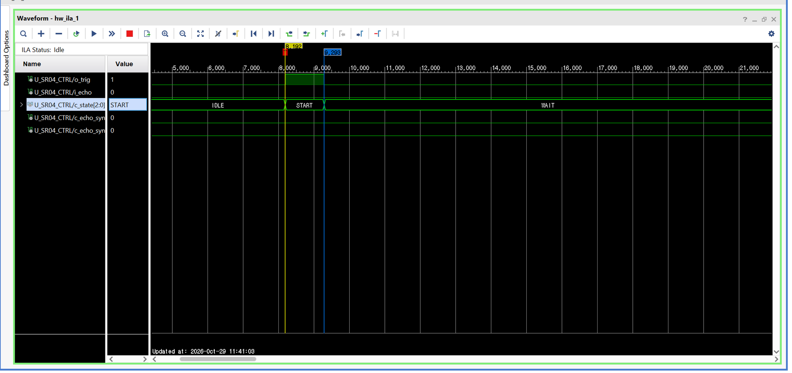
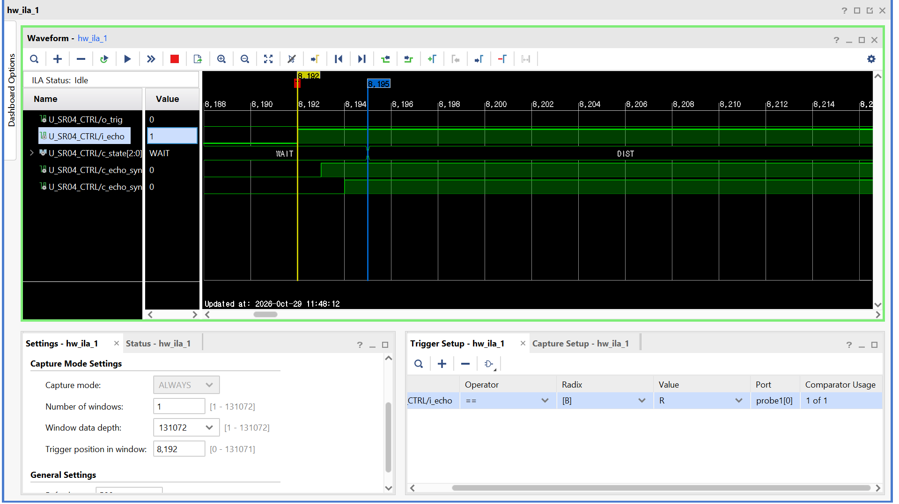
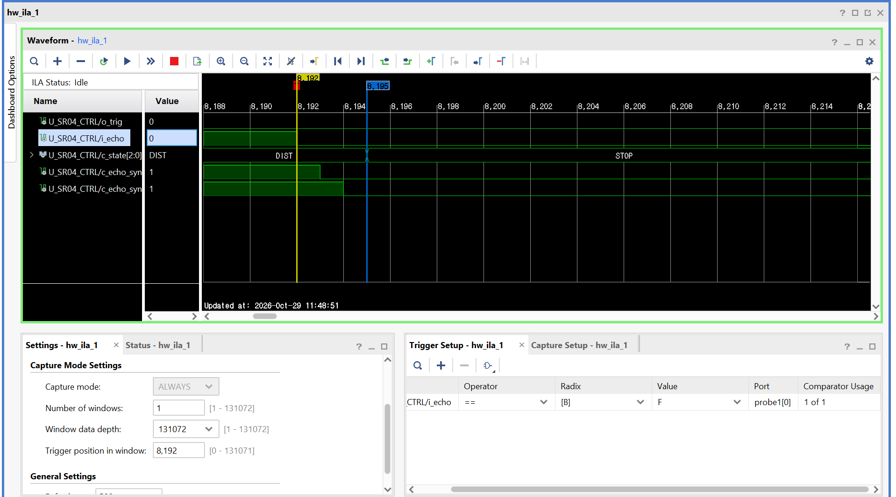
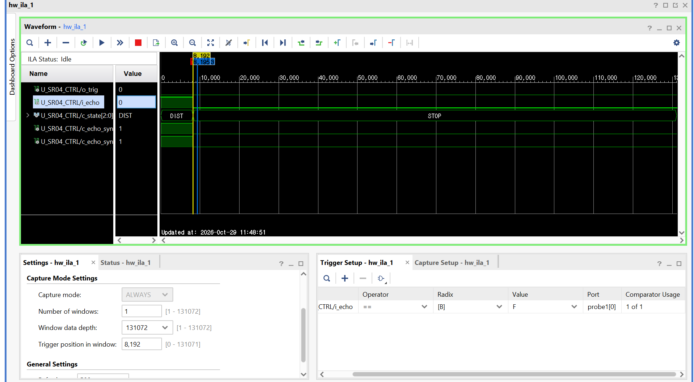
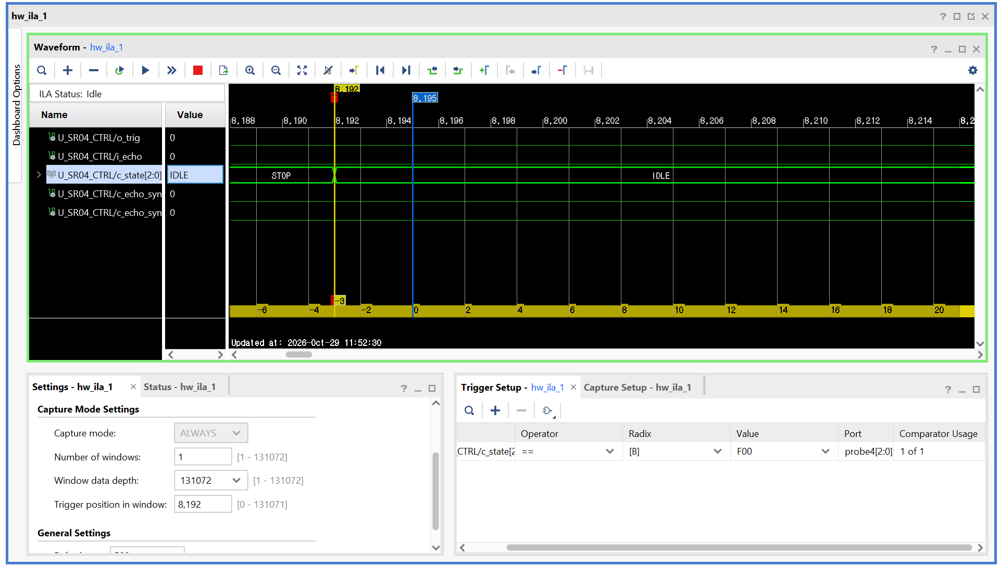

## 2. echo → DIST 지연 (3 샘플 / 2 샘플)

| 캡처 | echo 상승 | DIST 진입 | 차이 |
|---|---|---|---|
| `03` | 샘플 1 | 샘플 4 | 3 (대부분) |
| `02` · `04` | 샘플 1 | 샘플 3 | 2 (가끔) |
| `05` | sync1 · sync2 를 프로브에 추가해 한 칸씩 계단 확인 | | |

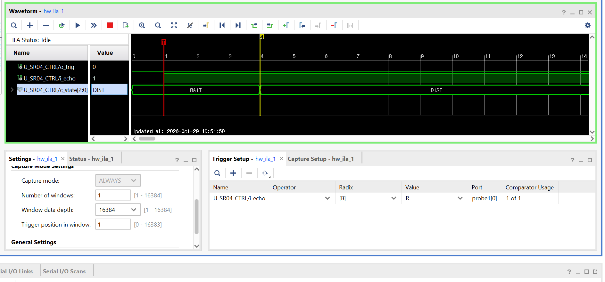
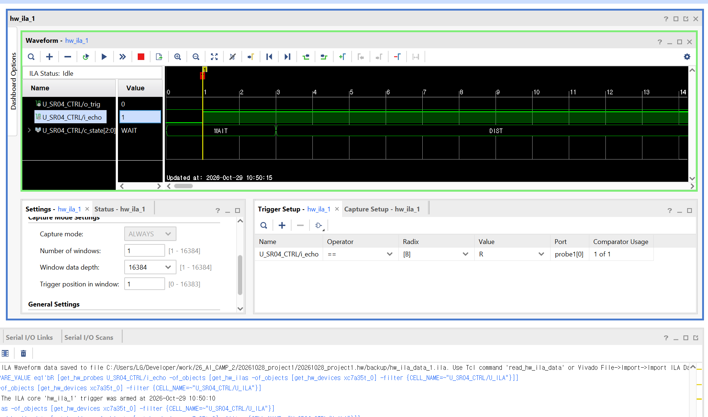
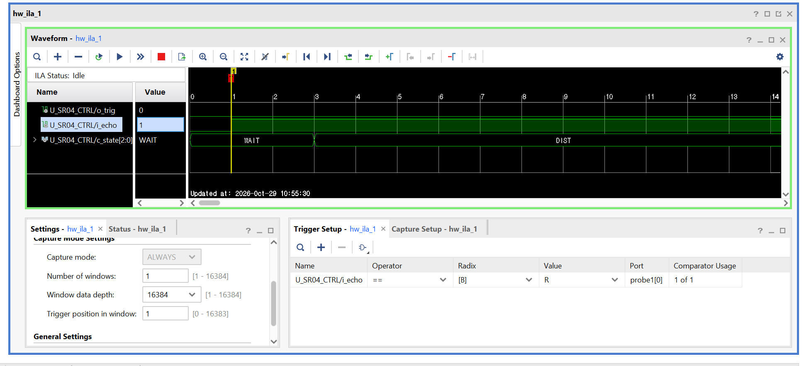
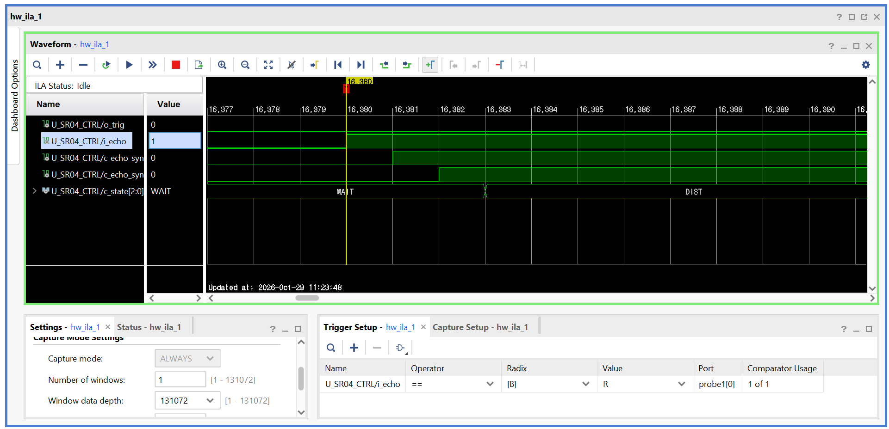
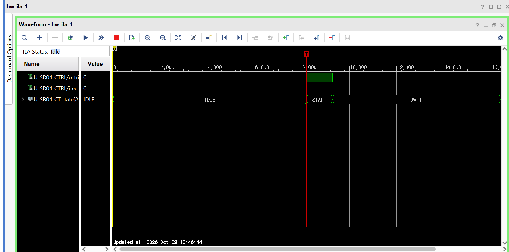

## 3. 거리 3 점 — ILA echo 폭 ÷ 58 vs FND

| 캡처 | echo (샘플) | 폭 | ÷ 58 | FND |
|---|---|---|---|---|
| `11` | 100 → 17,559 | 174.6 µs | 3.01 cm | 3 |
| `12` | 100 → 64,129 | 640.3 µs | 11.04 cm | 11 |
| `13` | 100 → 122,330 | 1,222.3 µs | 21.07 cm | 21 |

- 깊이 131,072 창 (≈ 1.31 ms) 이 echo 폭 기준 약 22 cm 까지라 그보다 먼 거리는 한 창에 다 안 들어감.

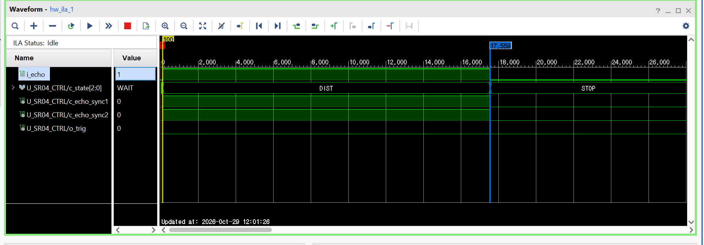
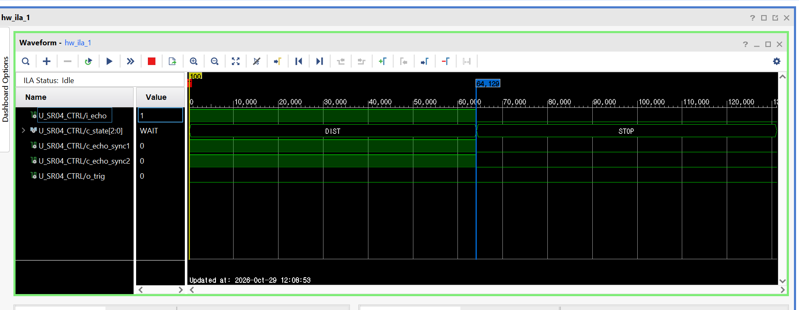
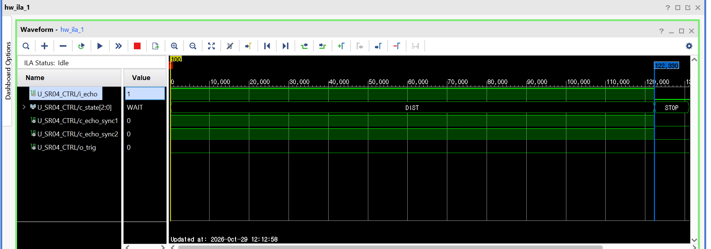

## 소스

`work/26_AI_CAMP_2/20261028_project1/20261028_project1.srcs/` — `sr04_controller.v` · `tick_gen_1us.v` · `top_sr04.v` (ILA 인스턴스 포함)
